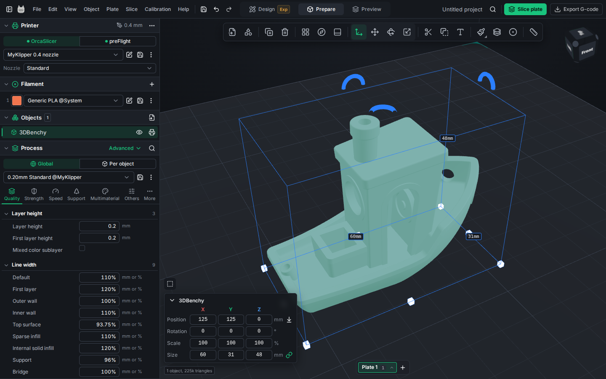
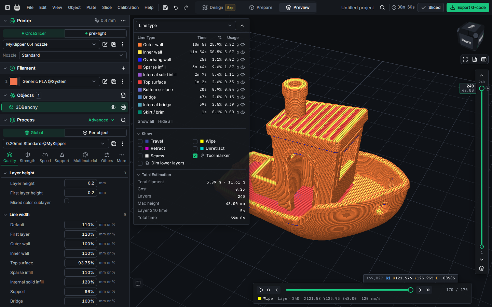
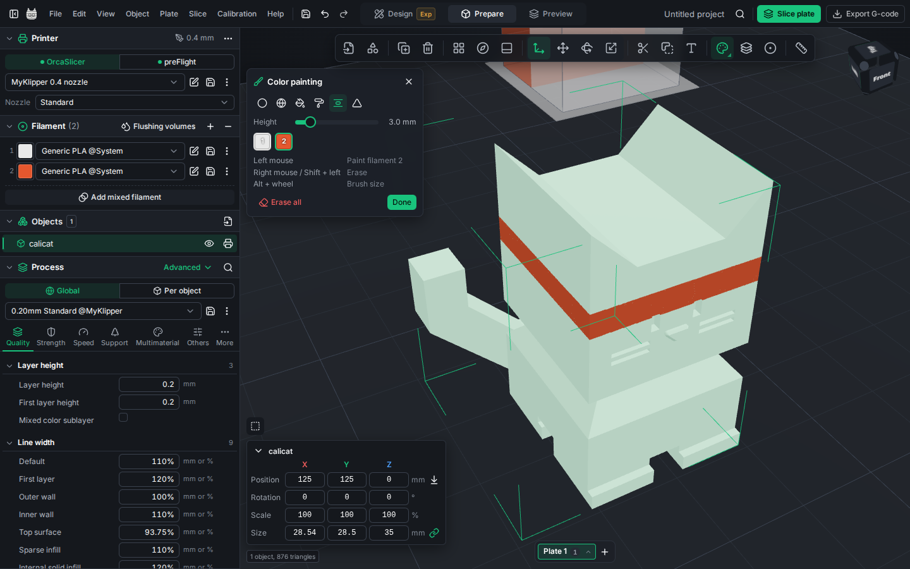
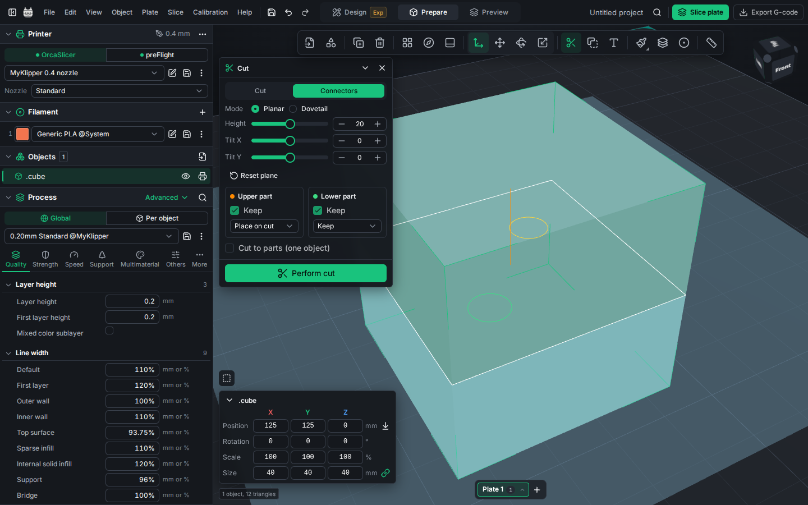
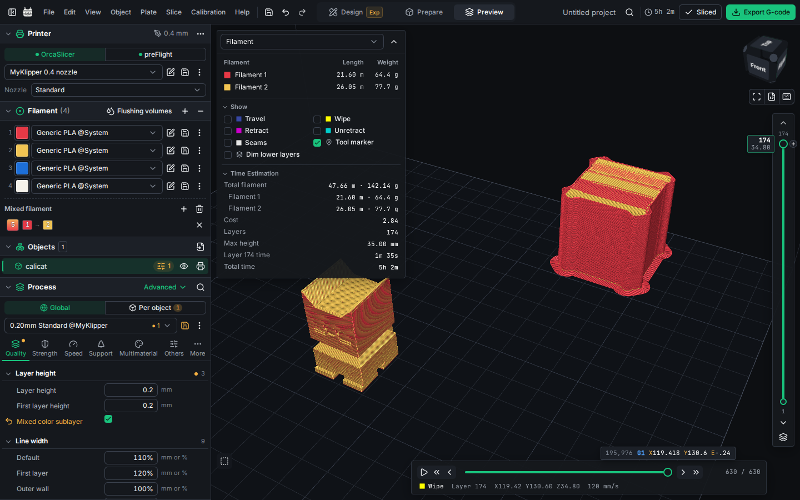

<p align="center"></p>

# CubbySlicer

A browser slicer built on OrcaSlicer and preFlight compiled to WebAssembly, live at [cubbycad.com/slicer](https://cubbycad.com/slicer).

It's the companion slicer for the [CubbyCAD editor](https://cubbycad.com/editor), a browser-based 3D CAD editor with CSG modeling, a 3D sketcher, a modifier stack and SDF sculpting. File ▸ Open Slicer in the editor sends the current model here.



The UI follows OrcaSlicer: plates, parts and modifiers, painting (support, seam, colour, fuzzy skin), cut with connectors, variable layer height, height ranges, calibration, print host upload, and Orca's full profile library. Projects save as OrcaSlicer-compatible 3MF (desktop Orca and Bambu Studio open them as projects), locally or to CubbyCAD workspaces, and Orca / Bambu project 3MFs open here with their plates, parts, painting and settings.

From OrcaSlicer 2.5:

- Mixed filaments: blend two or three filaments, or run a gradient between two over the height (with an optional custom curve). Translucent and multi-colour filament colours show in swatches and in the preview.
- Nozzle flow types and extruder variants (Standard / High Flow, dual nozzles, nozzle racks): pick each nozzle's flow type in the sidebar and edit per-nozzle values with the switch at the top of a settings page.
- Settings grey out or hide as in Orca, with the reason.
- Calibration: auto-scale for nozzle, VFA auto-adjust to the filament's max volumetric speed, belt-printer models.
- Speed Dial: Space opens the command palette; pin up to 10 commands there and run them with Alt+1–9 and Alt+0.
- Toolhead collision volumes, align / distribute, and precise seam modifiers (added, typed and saved in projects; the engine doesn't apply them yet).
- Filament sync from Moonraker printers (AFC / Happy Hare lanes), and UltiMaker print hosts.
- OrcaSlicer 2.5 Python plugins (File ▸ Plugins), unmodified, run in the browser with Pyodide: scripts in the command palette, slicing-pipeline hooks, G-code post-processing and plugin pages as their own tabs. Install only plugins you trust; see the user guide for what a browser can't do.

| | |
|---|---|
|  |  |
|  |  |

## Engines

| Engine | Version | Port | Upstream |
|---|---|---|---|
| OrcaSlicer | 2.5.0 | [orcaslicer-wasm](https://github.com/JoshTheDerf/orcaslicer-wasm) | [SoftFever/OrcaSlicer](https://github.com/SoftFever/OrcaSlicer) |
| preFlight | 1.3.0 | [preFlight-wasm](https://github.com/JoshTheDerf/preFlight-wasm) | [oozebot/preFlight](https://github.com/oozebot/preFlight) |

preFlight uses Orca's printer profiles, converted when loaded. The Full Spectrum engine is gone: OrcaSlicer 2.5 mixes colours itself (mixed filaments).

## Quick start

```sh
npm install
npm run dev      # http://localhost:5173/slicer/
npm test
npm run build    # dist/ (base /slicer/)
```

Engine builds go in `public/wasm/<engine>/` (not committed). See [docs/DEVELOPMENT.md](docs/DEVELOPMENT.md).

## Docs

- [User guide](docs/USER-GUIDE.md)
- [Development](docs/DEVELOPMENT.md)
- [Engine contract](docs/ENGINE-CONTRACT.md)

## License

AGPL-3.0-or-later ([LICENSE](LICENSE)), same as the engines. That's also why the slicer is separate from the CubbyCAD editor.
