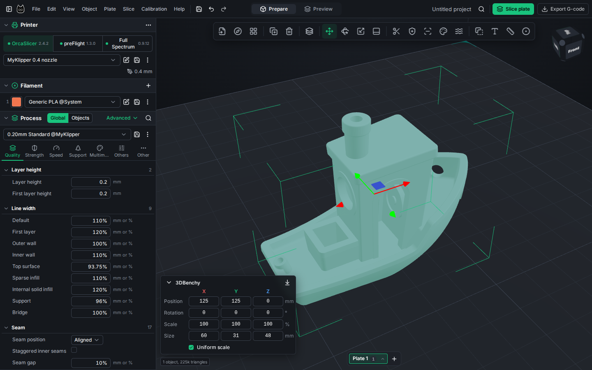
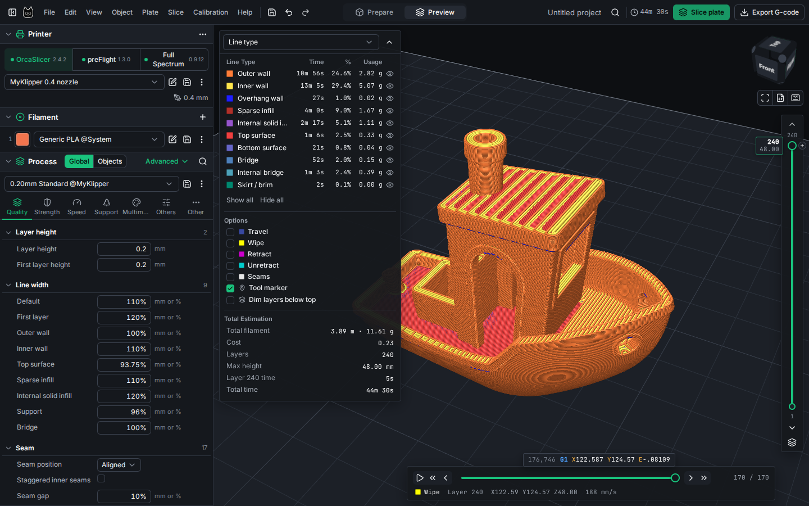
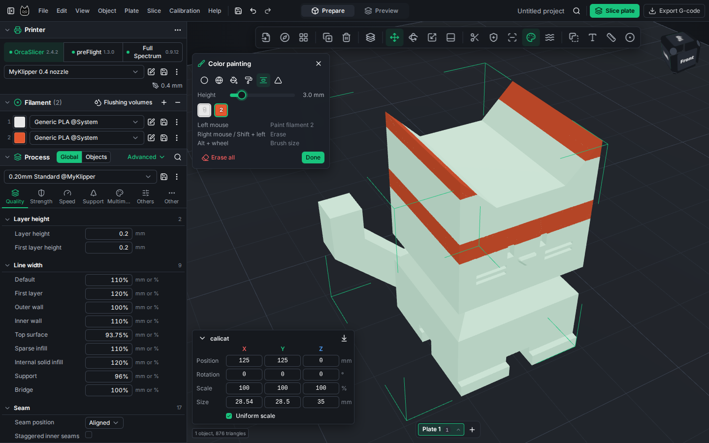
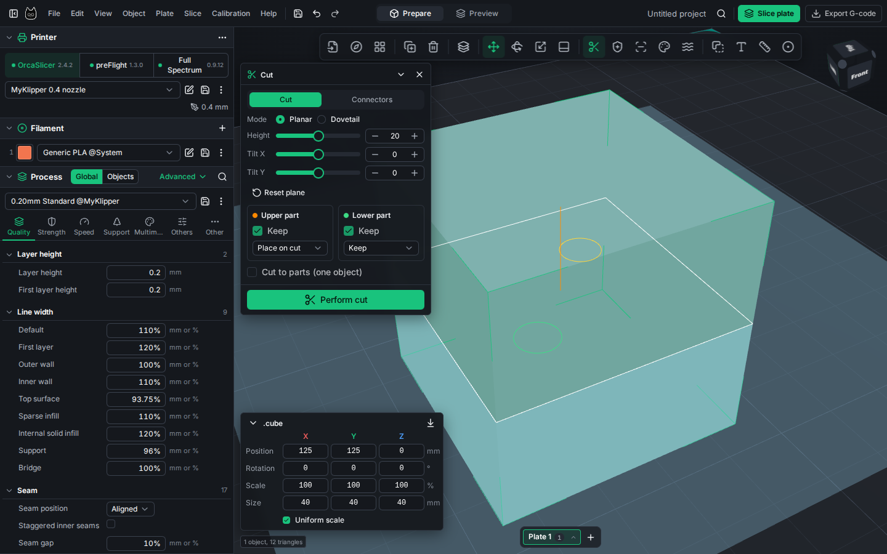
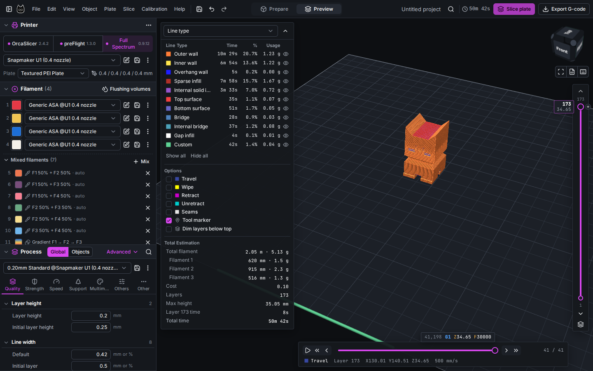

<p align="center"></p>

# CubbySlicer

A browser slicer built on OrcaSlicer, preFlight and Full Spectrum compiled to WebAssembly, live at [cubbycad.com/slicer](https://cubbycad.com/slicer).

It's the companion slicer for the [CubbyCAD editor](https://cubbycad.com/editor), a browser-based 3D CAD editor with CSG modeling, a 3D sketcher, a modifier stack and SDF sculpting. File ▸ Open Slicer in the editor sends the current model here.



The UI follows OrcaSlicer: plates, parts and modifiers, painting (support, seam, colour, fuzzy skin), cut with connectors, variable layer height, height ranges, calibration, print host upload, and Orca's full profile library. Projects save as OrcaSlicer-compatible 3MF (desktop Orca and Bambu Studio open them as projects), locally or to CubbyCAD workspaces, and Orca / Bambu project 3MFs open here with their plates, parts, painting and settings.

| | |
|---|---|
|  |  |
|  |  |

## Engines

| Engine | Version | Port | Upstream |
|---|---|---|---|
| OrcaSlicer | 2.4.2 | [orcaslicer-wasm](https://github.com/JoshTheDerf/orcaslicer-wasm) | [SoftFever/OrcaSlicer](https://github.com/SoftFever/OrcaSlicer) |
| preFlight | 1.3.0 | [preFlight-wasm](https://github.com/JoshTheDerf/preFlight-wasm) | [oozebot/preFlight](https://github.com/oozebot/preFlight) |
| Full Spectrum | 0.9.14 | [orcaslicer-wasm](https://github.com/JoshTheDerf/orcaslicer-wasm#full-spectrum) | [ratdoux/OrcaSlicer-FullSpectrum](https://github.com/ratdoux/OrcaSlicer-FullSpectrum) |

preFlight uses Orca's printer profiles, converted when loaded.

## Quick start

```sh
npm install
npm run dev      # http://localhost:5173/slicer/
npm test
npm run build    # dist/ (base /slicer/)
```

Engine builds go in `public/wasm/<engine>/` (not committed). See [docs/DEVELOPMENT.md](docs/DEVELOPMENT.md).

## Docs

- [User guide](docs/USER-GUIDE.md)
- [Development](docs/DEVELOPMENT.md)
- [Engine contract](docs/ENGINE-CONTRACT.md)

## License

AGPL-3.0-or-later ([LICENSE](LICENSE)), same as the engines. That's also why the slicer is separate from the CubbyCAD editor.
